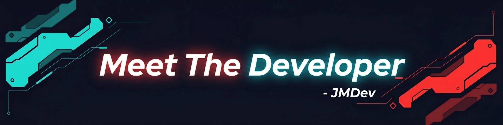

# Hello World!, I'm JMDev, a Next.js dev from Pangasinan

  

Welcome to my playground! I've been coding since 2020, exploring ideas, building projects, and continuously improving my skills along the way.My Portfolio Website is still a work in progress, but it already showcases the projects, experiments, and systems I've created through hands-on learning and real-world practice — this is where I share my journey as a developer.

### 💻 Tech Stack:

Lets hold it simple, there is much more but these tools are what I use daily: 

- Lang: Ts
- Framework: Next.js
- Styling: TailwindCSS & Shadcn

<picture>
  <source media="(prefers-color-scheme: dark)" srcset="https://raw.githubusercontent.com/tobiasmeyhoefer/tobiasmeyhoefer/output/github-snake-dark.svg" />
  <source media="(prefers-color-scheme: light)" srcset="https://raw.githubusercontent.com/tobiasmeyhoefer/tobiasmeyhoefer/output/github-snake.svg" />
  
</picture>
